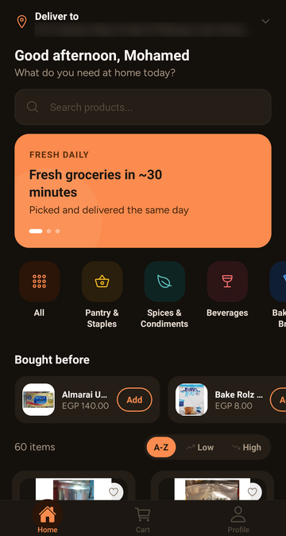
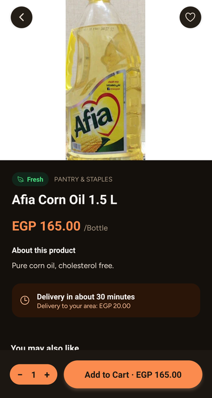
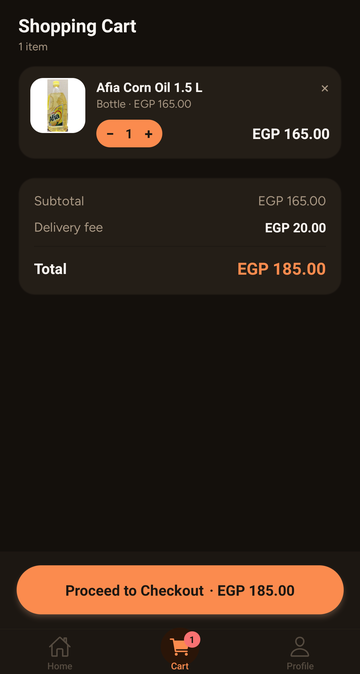
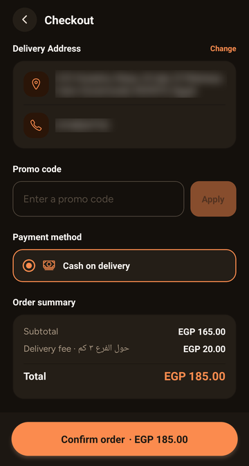
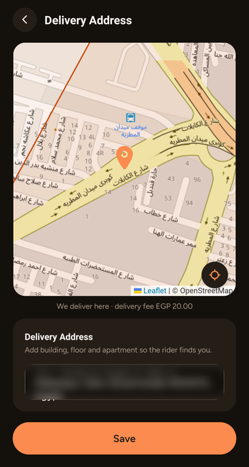
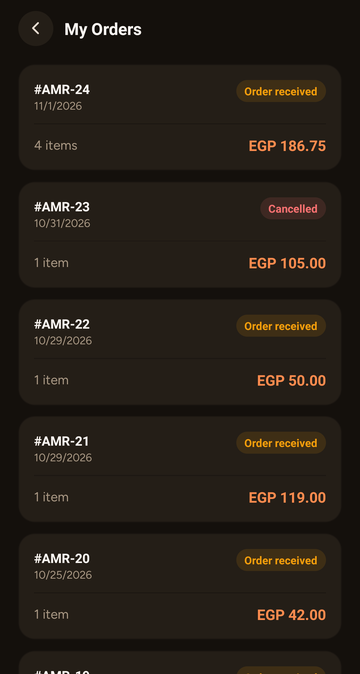
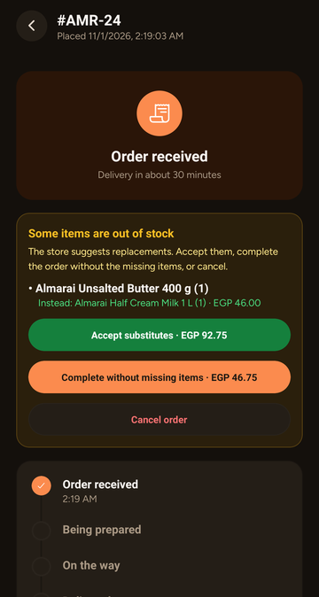
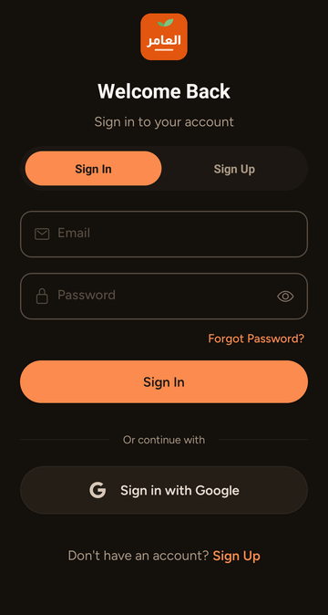

# El3amer

Customer app for El3amer, a neighbourhood grocery store. Customers browse the catalogue, fill a cart, drop a delivery pin on the map and pay cash on delivery (card payments via Kashier once enabled), then follow the order live.

Android first; built with Expo SDK 54, React Native 0.81 and Expo Router.

## Screenshots

| Home | Product | Cart | Checkout |
| --- | --- | --- | --- |
|  |  |  |  |

| Delivery pin | Orders | Missing items | Arabic |
| --- | --- | --- | --- |
|  |  |  |  |



## Related projects

| Project | What it is |
| --- | --- |
| `el3amer` (this repo) | Customer app |
| [`el3amer-store`](https://github.com/Mohamed0Hussein/el3amer-store) | Staff-only app: orders, drivers (WhatsApp), products, store settings |
| `el3amer-backend` (private) | Express + Postgres API on Vercel, live at https://el3amer-backend.vercel.app |

The app only talks to the backend; it never touches the database directly.

## Features

- Email or Google sign-in, password reset by emailed code, account deletion
- Arabic and English, light and dark theme
- Search, categories, favourites saved to the account, "buy again" on the home screen
- Items sold by piece or by weight (price follows the chosen weight)
- Per-customer purchase limits set by the store
- Delivery pin on an OpenStreetMap map; orders outside the delivery zones are refused
- Delivery fee shown before checkout, promo codes at checkout
- Live order status with push notifications
- Missing items: the store can offer one or more substitutes; the customer accepts them, completes without the missing items, or cancels
- Offline banner, error reporting (Sentry), over-the-air updates and a prompt when a new APK is required

## Getting started

Requirements: Node 20.19+, npm, Android Studio (emulator or a device with USB debugging).

```bash
npm ci
```

Copy `.env.example` to `.env` and fill it in:

```bash
cp .env.example .env
```

`EXPO_PUBLIC_API_URL` falls back to `expo.extra.apiUrl` in `app.json`. Point it at a local backend (for example `http://192.168.1.10:3000`) to develop against your own server. Never commit `.env`.

The app uses native modules (secure store, notifications, Sentry), so Expo Go is not enough. Build a development client once, then start Metro:

```bash
npx expo run:android
```

```bash
npm start
```

Lint:

```bash
npm run lint
```

## Builds and releases

EAS profiles live in `eas.json`:

- `development`: dev client
- `preview`: installable APK on the `preview` channel (what the store currently uses)
- `production`: Play Store build on the `production` channel

```bash
npx eas-cli build --platform android --profile preview
```

After a new APK, update `RELEASES` in the backend's `routes/appVersion.js` (latest version, minimum version, download URL) so older installs are told to update.

### Over-the-air updates

`runtimeVersion` follows the app version, so an update only reaches installs with the same `version` from `app.json`. JavaScript-only changes can ship without a new APK:

```bash
npx eas-cli update --channel preview --environment preview --platform android --message "..."
```

To reach older installs, publish again with `version` temporarily set to that runtime, then restore `app.json`. Runtimes built before the SDK patch bump in 1.1.3 must be published from code at that older dependency set, not from the current tree. Any change to native code or dependencies needs a new APK instead.

## Project structure

```
app/            Screens (Expo Router). (auth) = login/sign-up, (tabs) = home, cart, profile
components/     Shared UI: product card, pin map, skeletons, error boundary, update prompt
context/        Auth, cart, favourites, language
services/       API calls (axios), one file per backend resource
hooks/          Data hooks (products, store settings, delivery) and theme helpers
constants/      Theme tokens, routes, formatting, delivery zone helpers
lib/            Sentry, notifications, query client, session, global error handler
localization/   Arabic and English strings
config/env.ts   Resolves the API URL
```

Release-only setup (Kashier, Brevo, Firebase, map tiles) is tracked in [SHIPPING_CHECKLIST.md](SHIPPING_CHECKLIST.md).

## License

The code is released under the [MIT License](LICENSE).

The El3amer name, logo and app icons belong to the El3amer store and are not covered by the license. Use your own branding if you build on this code.
